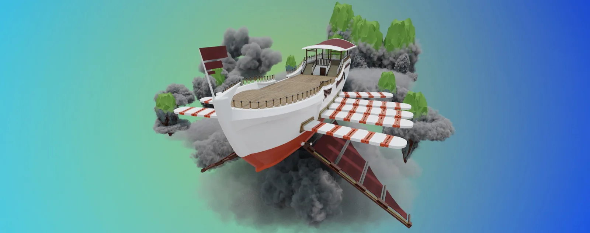
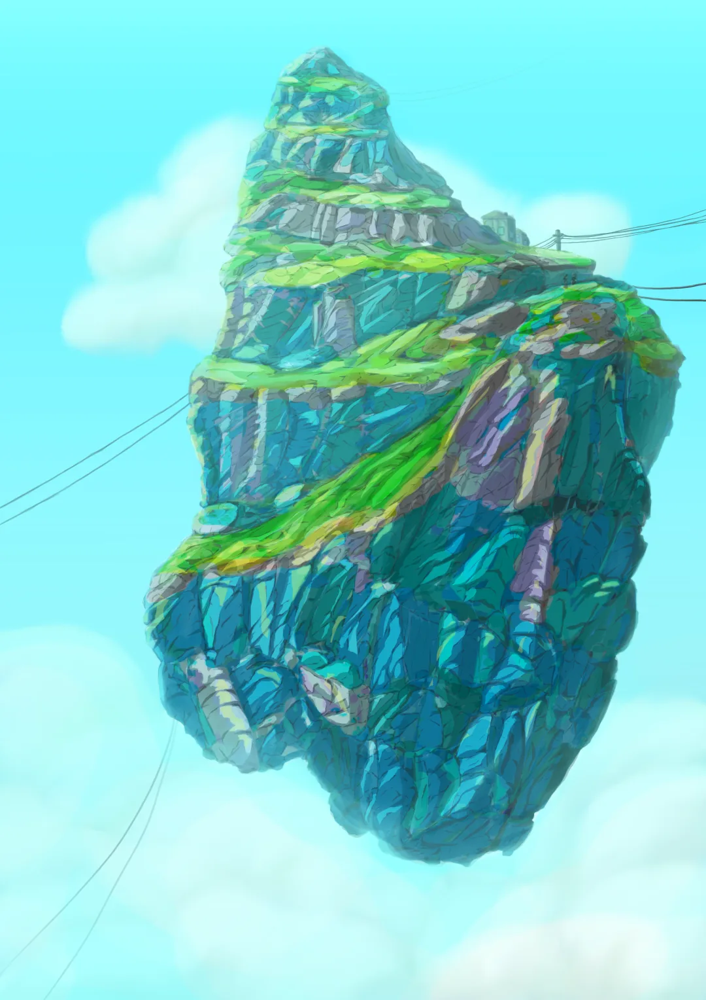

Imagine a world where rocks float in the sky, and giant mega-amoebas take the place of planets. Floating islands are covered in villages and forests. Airships traverse a layered atmosphere teeming with life, lit by artificial stars and steeped in the echoes of extinct civilizations. This is Soaring Islands.
What is This World?

Unlike our own universe, Soaring Islands is a reality before the Big Bang. Space here is not empty. It is filled with a dense atmosphere saturated with gases, oxygen, and volatile elements that form atmospheric strata, through which floating islands and creatures drift.
How Does It Work?

Energy and Light: The sources of energy and light are Generators—micro-stars that periodically contract to draw in surrounding matter (night) and then expand (day) to emit light and heat. These Generators were built by the Ancients.

Mega-Amoebas: There are no planets in this world as we know them. Instead, there are colossal proto-organisms called mega-amoebas. Over time, they become encrusted with a solid shell and act as centers of gravity for smaller objects in the world. Alongside them, the skies are full of diverse life: giant flying beasts, birds, humans, and other species.

Atmospheric Layers and Buoyancy: The foundation of Soaring Islands' multi-layered structure lies in volatile gases that mix with massive amounts of oxygen and other elements to form distinct atmospheric strata. The higher the concentration of volatile gases in the air, the stronger the upward buoyant force, governed by Archimedes' principle.

Soaring Ore: Islands, giant fauna, and certain flora possess their own buoyancy coefficient thanks to soaring ore—a stone ore with volatile gas molecules trapped inside its crystalline lattice. On its own, soaring ore is extremely brittle, but when fused with other minerals and metals, it forms a sturdy foundation for floating rocks, cliffs, and islands. Under heat and pressure, soaring ore transforms into a soaring ore crystal—a heavy mineral that always remains suspended at a specific atmospheric layer depending on its purity and weight.

Gravity and atmospheric density behave differently across altitudes, shaping unique ecosystems and living conditions at every level.
Origins and the Ancients

A race of beings who mastered time and space is known as the Ancients. For millennia, they conducted vast research, only to vanish suddenly, leaving behind the ruins of an advanced infrastructure and powerful technological artifacts.
Factions and Ideology

At the time of the stories I will be telling, two major factions dominate the world of Soaring Islands:
The Artisans

Craftsmen living in small communities on isolated islands, where everyone practices their trade with devotion, and progress happens slowly with deep respect for tradition. The inhabitants of these islands live by the principles of self-sufficiency, using resources sparingly and treating nature as sacred. Their handcrafted goods are renowned for their quality and uniqueness, and every island takes pride in its masters—whether blacksmiths, potters, weavers, or woodcarvers.

    Live in harmony with nature.

    Create architecture and technology that blend art, craftsmanship, and sustainability.

    Build settlements that seamlessly integrate into the natural landscape of the islands.

The Empire

An empire organized around industrialization and resource extraction. Imperials view themselves as more "progressive," aggressively advancing technology to achieve maximum efficiency and wealth. Their engineering enables the construction of massive factories and machines, yet it alienates them from nature, which they view strictly as a resource to be exploited. The Empire expands its reach by subjugating more islands and seizing control of their natural and artisanal wealth. Its citizens live on artificial islands forged from metal. Constant production demands ever-increasing resources; if extraction stops, the Empire can no longer sustain itself.

    Pursues ideals of progress, order, and expansion.

    Built on mass industrialization, colonization, and resource extraction.

    Deploys heavy airships, iron citadels, and technologies for processing biological forms.

Technology and Devices

    No Magic: Everything is explained through local science and the technology of the Ancients.

    Mechanics: Machinery runs on clockwork springs, steam engines, and electrical power.

    Ancient Legacy: Functional remnants of the Ancients still exist across the world, including beacons, navigation cores, living mechanisms, energy generators, and genetic experiments.

Core Conflict

    An ideological and technological clash between creation (art and craft) and exploitation (heavy industry).

    The world exists in a state of fragile equilibrium, threatened by localized wars, catastrophes, soaring ore depletion, and the collapse of sustainable ecosystems.

Universe Formats

    City-Building Strategy Games: Spire Survive Town, Spirelight, and Soaring Islands.

    VR Experience: A game centered on piloting an airship, prospecting for ore mines, and establishing links between islands (SI: Laying Out Communication and Navigation Networks).

    Visual & Narrative Media: Concept illustrations, comics, short stories, full-length lore videos, and deep-dive lectures.

    Cinema: A future feature-length film.

This is the foundational overview to help you understand what the world of Soaring Islands is all about.

