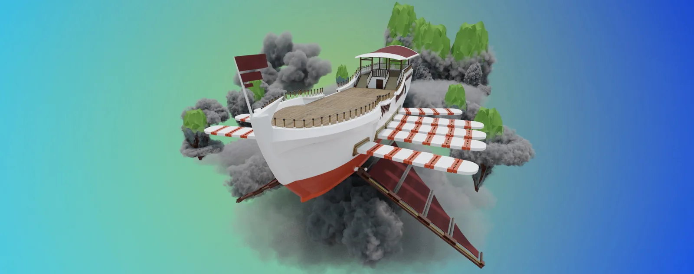
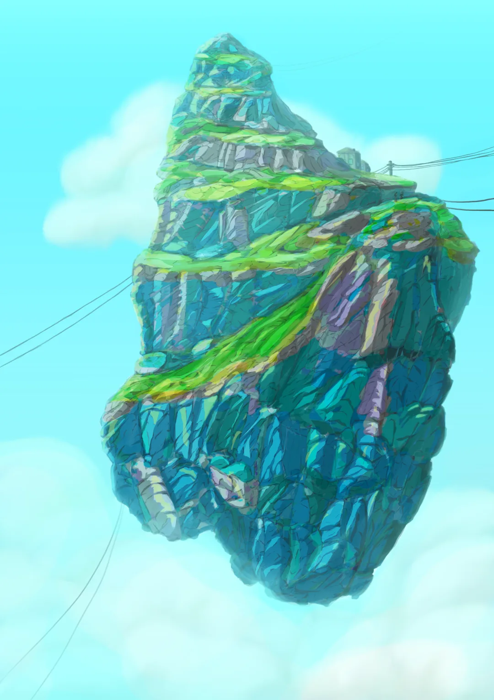

Imagina un mundo donde las rocas flotan en el cielo y, en lugar de planetas, existen gigantescas mega-amebas. Islas flotantes cubiertas de aldeas y bosques. Barcos voladores que surcan una atmósfera estratificada llena de vida, la luz de estrellas artificiales y el aliento de civilizaciones extintas. Esto es Soaring Islands.

¿Qué es este mundo?
A diferencia de nuestro universo habitual, Soaring Islands es una realidad anterior al Big Bang. Aquí el espacio no está vacío; está lleno de una atmósfera densa, saturada de gases, oxígeno y elementos volátiles que forman capas atmosféricas por las cuales van a la deriva islas flotantes y criaturas.

¿Cómo funciona?
Las fuentes de energía y luz son los generadores: microestrellas que se contraen periódicamente para absorber la materia circundante (noche) y luego se expanden (día) para emitir luz y calor. Estos generadores fueron creados por los Antiguos.

En este mundo no existen los planetas como tales, sino enormes protoorganismos: las mega-amebas. Estos organismos desarrollan una corteza sólida y actúan como centros de atracción gravitacional para los objetos más pequeños del mundo. Además de las mega-amebas, este mundo rebosa de otras formas de vida: gigantescos animales voladores, aves, humanos y muchas otras especies.

La base de la estructura en capas de Soaring Islands son los gases volátiles que, al mezclarse con enormes cantidades de oxígeno y otros gases, forman los estratos atmosféricos. Cuanto mayor es la concentración de gases volátiles en el aire, mayor es la fuerza de empuje según el principio de Arquímedes.

Las islas, los animales gigantes y algunas plantas tienen su propio coeficiente de flotabilidad gracias a la mena flotante. La mena flotante es un mineral pétreo en cuya red cristalina quedan atrapadas moléculas de gases volátiles. Por sí sola es muy frágil, pero al mezclarse con otros minerales y metales se convierte en una base sólida que da origen a piedras, peñascos e islas flotantes. Bajo los efectos de la temperatura y la presión, puede transformarse en un cristal de mena flotante: un mineral pesado que siempre permanece en una misma capa atmosférica según su pureza y peso.

La gravedad y la densidad de la atmósfera se comportan de manera distinta a diferentes altitudes, dando lugar a ecosistemas y condiciones de vida únicos.

Origen y los Antiguos
La raza de seres que logró dominar el tiempo y el espacio se conoce como los Antiguos. Durante milenios llevaron a cabo investigaciones, hasta que desaparecieron repentinamente, dejando tras de sí ruinas de una infraestructura avanzada y artefactos tecnológicos.

Facciones y su ideología
En el momento en que transcurren los acontecimientos que voy a narrar, existen dos grandes facciones en el mundo de Soaring Islands:

    Los Artesanos (Artisans):
    Artesanos que viven en pequeñas comunidades en islas aisladas, donde cada persona se dedica a su oficio poniendo el alma en su trabajo, y el desarrollo avanza lentamente y con respeto por las tradiciones. Los habitantes de estas islas siguen principios de autosuficiencia, utilizando los recursos con moderación y considerando la naturaleza como algo sagrado. Sus creaciones son famosas por su calidad y singularidad, y cada isla se enorgullece de sus maestros, ya sean herreros, alfareros, tejedores o talladores de madera.

        Viven en armonía con la naturaleza.

        Crean arquitectura y tecnologías que combinan arte, oficio y sostenibilidad.

        Sus asentamientos se integran de forma orgánica en el paisaje de las islas.

    El Imperio:
    Una potencia organizada en torno a la industrialización y la apropiación de recursos. Los imperiales se consideran más «progresistas» y desarrollan tecnologías de forma activa para alcanzar la máxima eficiencia y el enriquecimiento. Sus avances les permiten construir enormes fábricas y maquinaria, pero los alejan de la naturaleza, a la que ven únicamente como un recurso para sus necesidades. El Imperio expande su dominio buscando someter cada vez más islas y controlar sus riquezas naturales y artesanales. Sus habitantes viven en islas artificiales hechas de metal. La producción constante exige cada vez más materias primas; si la extracción se detiene, el Imperio no podrá sostenerse a sí mismo.

        Persigue ideales de progreso, orden y expansión.

        Se basa en la industrialización masiva, la colonización y la extracción de recursos.

        Utiliza poderosos dirigibles, ciudadelas de hierro y tecnologías para procesar formas biológicas.

Tecnología y dispositivos

    No existe la magia. Todo se explica mediante la ciencia local y las tecnologías de los Antiguos.

    Los mecanismos funcionan con resortes de cuerda, motores de vapor y energía eléctrica.

    El legado de las civilizaciones antiguas dejó artefactos funcionales: faros, núcleos de navegación, mecanismos vivientes, generadores de energía y experimentos genéticos.

El conflicto principal

    Un enfrentamiento ideológico y tecnológico entre la creación (el arte) y la explotación (la industria).

    El mundo se encuentra en un frágil equilibrio marcado por guerras locales, catástrofes, fugas de mena y la pérdida de ecosistemas sostenibles.

Formatos de desarrollo del universo

    Videojuegos de estrategia y construcción de ciudades (Spire Survive Tower, Spirelight, Soaring Islands).

    Un juego de realidad virtual (VR) centrado en el pilotaje de dirigibles, la búsqueda de minas y la conexión entre islas (SI: Laying out communication and navigation networks).

    Ilustraciones artísticas, cómics, relatos, videos completos y charlas sobre el lore.

    Un futuro largometraje.

Esta es la información básica para comprender qué es el mundo de Soaring Islands.

