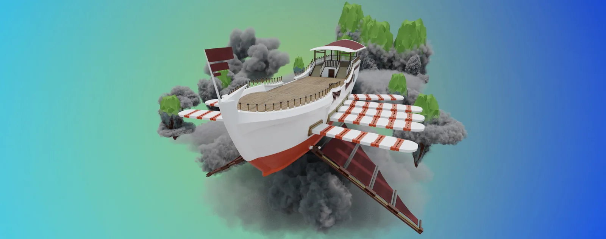
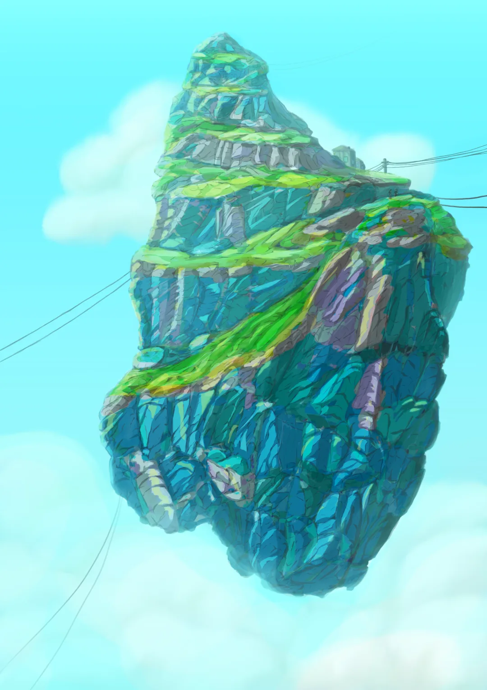

Представьте себе мир, где скалы плавают в небе, а вместо планет гигантские мега-амебы. Парящие острова обросшие деревнями и лесами. Летающие корабли пересекают слоистую атмосферу наполненную жизнью, светом искусственных звёзд и дыханием вымерших цивилизаций. Это и есть Soaring Islands.

### Что это за мир?

В отличие от привычной нам вселенной, Soaring Islands это реальность до большого взрыва. Космос здесь не пустой. Он наполнен плотной атмосферой, насыщенной газами, кислородом и летучими элементами, образующими атмосферные слои, по которым дрейфуют парящие острова и существа.

### Как он устроен?

Источники энергии и света - генераторы, это микро звезды которые периодически сжимаются чтобы втянуть в себя окружающую материю (ночь) и затем расширяются (день) чтобы испускать свет и тепло. Генераторы были созданы Древними.

Как таковых планет в этом мире нет,  зато есть гигантские прото-организмы: мега-амебы. Эти организмы обрастают твердой коркой к являются центрами притяжения для меньших объектов этого мира.

Кроме мега-амеб в этом мире полно другой жизни, гигантские летающие животные, птицы, люди и другие.

Основа многослойности мира Soaring Islands это летучие газы, которые смешиваясь с огромным количеством кислорода и другими газами составляют слои атмосферы. Чем выше концентрация летучих газов в воздухе, тем сильнее выталкивающая сила из закона Архимеда.

Острова, гигантские животные и некоторые растения имеют свой коэффициент выталкивающей силы благодаря парящей руде. 

Парящая руда это каменная руда в кристаллической решетке которой заключены молекулы летучих газов. Сама по себе парящая руда очень хрупкая, но смешиваясь с другими минералами и металлами парящая руда становится крепким основанием для  возникновения парящих камней, скал и островов. При воздействии температуры и давления парящая руда может стать кристаллом парящей руды - это тяжелый минерал который всегда находится на одном слое атмосферы в зависимости от своей чистоты и веса.

Гравитация и плотность атмосферы ведут себя иначе на разных высотах, формируя уникальные экосистемы и условия для жизни. 

### Происхождение и Древние

Раса существ подчинивших время и пространство называется Древние. Тысячелетиями они проводили исследования, а потом внезапно исчезли оставив после себя руины развитой инфраструктуры и технологические артефакты.

### Фракции и их идеология

На момент событий, о которых я буду рассказывать,  в мире Soaring Islands существуют две крупные фракции:

**Мастера (Artisans):**

Ремесленники, живущие в маленьких общинах на изолированных островах, где каждый занимается своим ремеслом, вкладывая душу в работу, а развитие происходит медленно и с уважением к традициям. Жители этих островов следуют принципам самодостаточности, используя ресурсы экономно и считая природу священной. Их ремесленные изделия славятся качеством и уникальностью, и каждый остров гордится своими мастерами будь то кузнецы, гончары, ткачи или резчики по дереву.

- Живут в гармонии с природой.
- Создают архитектуру и технологии, сочетающие искусство, ремесло и устойчивость.
- Их поселения органично вписаны в ландшафт островов.

**Империя:**

Империя, организованная вокруг индустриализации и захвата ресурсов. Имперцы считают себя более «прогрессивными», активно развивая технологии, чтобы достичь максимальной эффективности и обогащения. Их технологии позволяют строить огромные фабрики и машины, но они отдаляются от природы, рассматривая ее только как ресурс для своих нужд. Империя распространяет свою власть, стремясь подчинить все больше островов и установить контроль над их природными и ремесленными богатствами. Жители живут на искусственных островах из метала. Постоянное производство требует все больше и больше ресурсов, если добыча прекратится, то Империя не сможет обеспечивать себя.

- Преследует идеалы прогресса, порядка и экспансии.
- Основана на массовой индустриализации, колонизации и добыче ресурсов.
- Использует мощные дирижабли, железные цитадели и технологии переработки биологических форм.

### **Технологии и устройства**

- Магии нет. Всё объясняется локальной наукой, технологиями древних.
- Механизмы работают на заводных пружинах, паровых двигателях, энергии электричества.
- Наследие древних цивилизаций оставило функциональные артефакты: маяки, навигационные ядра, живые механизмы, генераторы энергии, генетические  эксперименты.

### **Основной конфликт**

- **Идеологическое и технологическое противостояние** между созиданием (искусство) и эксплуатацией (промышленность).
- Мир находится в состоянии хрупкого равновесия — локальные войны, катастрофы, утечка руды и потеря устойчивых экосистем.

### **Форматы развития вселенной**

- Градостроительные стратегические игры (*Spire Survive Tower, Spirelight, Soaring Islands*).
- VR-игра с управлением дирижаблем, поиском рудников и связью между островами (SI: Laying out communication and navigation networks).
- Художественные иллюстрации, комиксы, рассказы, полноценные видео и лекции о лоре.
- Будущий полнометражный фильм.

Это базовая информация для понимания что же такое мир Soaring Islands.

