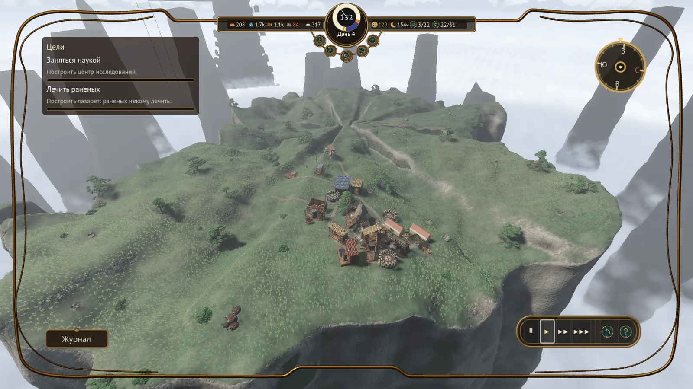

My journey into game development began with The Games Factory, an engine that came on a CD bundled with a book about making games. Back then, I was just learning how to use a computer and wanted to create something similar to Heroes of Might and Magic. That game sparked a passion for game development that has stayed with me for the rest of my life.

Next came 3D engines like Cube, the Unreal Development Kit (UDK), and the Hammer Editor. I didn't accomplish much at the time—I tried building things using rare forum threads and scattered tutorials, but I lacked the knowledge and experience to pull off even the simplest mechanics.

That was when I started learning 3D modeling with Blender. Even though it wasn't popular back then and had a steep learning curve, I found it more intuitive and accessible than its competitors. Its open-source nature and creative freedom proved decisive for my growth.

Over time, I gained a much clearer understanding of how games are actually made, largely thanks to YouTube, where in-depth videos and full courses on the exact topics I needed were starting to appear. I began to truly grasp the full game development pipeline—from creating 3D assets to implementing gameplay logic inside an engine.

For a long time, I searched for a job in the games industry to gain hands-on experience, but breaking in proved tough. I worked outside the industry and studied in the evenings, sharpening my skills, practicing patience, and developing my artistic eye.

For a while, I worked as a freelancer, taking on commissions for animation studios, creating visualizations for oil and gas projects, and modeling interiors for architectural firms.

In 2020, I finally stepped into the spotlight with a game project of my own. I entered the Unreal Engine Dev Contest 2020 with a [prototype of Soaring Islands](https://unrealcontest.ru/2020/game/738/)

Throughout development, I kept a [devlog](https://dtf.ru/indie/768757-postmortem-soaring-islands-heroes-of-exploration)

I also built a [showcase website](https://sites.google.com/view/tuosi/index-en)

And released a public [demo of the prototype](https://indiecup.net/eastern-europe/participants/soaring-islands-heroes-of-exploration.html)

After the war broke out, I had to leave my country. Thanks to the support of my friends, I was able to relocate and start my life over from scratch in a new place.

At first, I volunteered with a local community helping others fleeing the war.

Some time later, I stumbled across a job posting in a local chat looking for 3D modelers for a mobile racing game. I applied, sent over my portfolio (having a portfolio ready when you apply is crucial), and got hired to work on a car mechanic simulator. On that project, I modeled vehicles and their individual parts in fine detail, keeping mobile development constraints in Unity and optimization for low-end devices in mind.

Eventually, I was transferred to the studio's flagship project, where I still work today. Over the past two and a half years, I’ve learned a tremendous amount about how cars are built and engineered, as well as their design and history.

I’m grateful to be working in such an inspiring and creative industry. Even after two and a half years, I learn something new every single day and gain unique experience.

Now, the initial shock of the war has finally subsided, and I’m ready to continue building the universe of Soaring Islands.

Wishing everyone kindness and fair winds!

