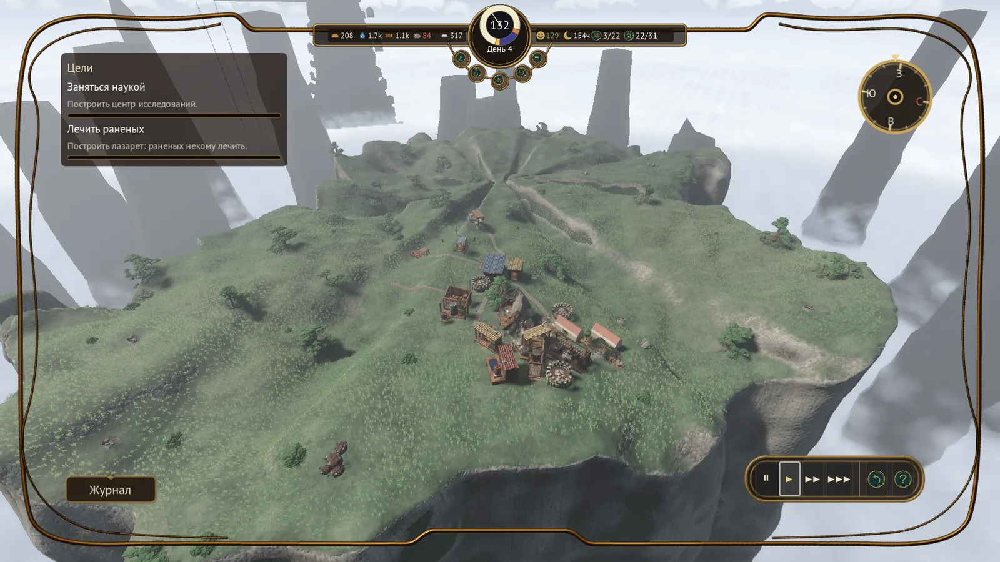

Mi camino en el desarrollo de videojuegos comenzó con el motor The Games Factory, que venía en un CD junto con un libro sobre creación de juegos. En aquel entonces apenas estaba aprendiendo a usar la computadora y me llamaba la atención hacer algo parecido a Heroes of Might and Magic. Fue precisamente ese juego el que despertó en mí la pasión por el desarrollo de videojuegos para el resto de mi vida.

Después vinieron los motores 3D: 3D Cube, Unreal Development Kit y Hammer Engine. No logré mucho en esa etapa; intenté crear cosas siguiendo escasos tutoriales y lecciones de foros, pero me faltaban conocimientos y experiencia incluso para las mecánicas más simples.

Fue entonces cuando empecé a aprender modelado 3D con Blender 3D. Aunque en aquella época no era popular y resultaba difícil de dominar, a mí me pareció más cómodo y comprensible que sus competidores. Su carácter abierto y la libertad que ofrecía fueron decisivos para mi desarrollo.

Con el tiempo empecé a comprender mejor cómo funciona el proceso de creación de videojuegos, por suerte en YouTube comenzaron a aparecer videos detallados y cursos completos sobre los temas que me interesaban. Empecé a entender de verdad cómo está estructurado el desarrollo: desde el pipeline de modelos 3D hasta la lógica de las mecánicas dentro del motor.

Durante mucho tiempo busqué trabajo en la industria de los videojuegos para ganar experiencia práctica, pero no lograba conseguir un puesto. Trabajaba fuera del sector y estudiaba por las tardes, perfeccionando mis habilidades, entrenando la paciencia y desarrollando mi criterio visual.

Durante un tiempo trabajé como freelance: realicé encargos para estudios de animación, hice visualizaciones de proyectos petroleros y modelé interiores para proyectos arquitectónicos.

En 2020 salí «a la luz» por primera vez con mi propio proyecto de videojuego. Participé en el concurso de desarrollo Unreal Engine Dev Contest 2020 con el prototipo [de Soaring Islands](https://unrealcontest.ru/2020/game/738/)

Durante el desarrollo llevé diarios [de trabajo](https://dtf.ru/indie/768757-postmortem-soaring-islands-heroes-of-exploration)

Sitio web [de presentación](https://sites.google.com/view/tuosi/index-en)

Y publiqué una demo abierta [del prototipo](https://indiecup.net/eastern-europe/participants/soaring-islands-heroes-of-exploration.html)

Tras el inicio de la guerra tuve que abandonar mi país. Gracias al apoyo de mis amigos pude irme y empezar mi vida desde cero en otro lugar. Al principio fui voluntario en una comunidad que ayudaba a quienes huían de la guerra.

Pasado un tiempo, me topé con un anuncio en un chat local en el que buscaban modeladores 3D para un juego móvil de carreras. Me postulé, envié mi portafolio (es fundamental tener un portafolio para mostrar de qué eres capaz al aplicar) y me contrataron para un proyecto de simulador de mecánica automotriz. En ese proyecto modelaba autos y sus piezas con todo lujo de detalles, teniendo en cuenta las particularidades del desarrollo móvil en Unity y la optimización para dispositivos de gama baja.

Con el tiempo me trasladaron al proyecto principal, donde sigo trabajando hasta hoy. En estos dos años y medio he aprendido muchísimo sobre la estructura y el funcionamiento de los automóviles, su diseño y su historia.

Me alegra poder trabajar en esta industria tan fascinante y creativa. Incluso después de dos años y medio, cada día aprendo algo nuevo y adquiero una experiencia única.

Ahora ha llegado el momento en que ha pasado el primer impacto por el inicio de la guerra y puedo retomar el trabajo en el universo de las islas flotantes.

¡Les deseo todo lo mejor y buen viento!

