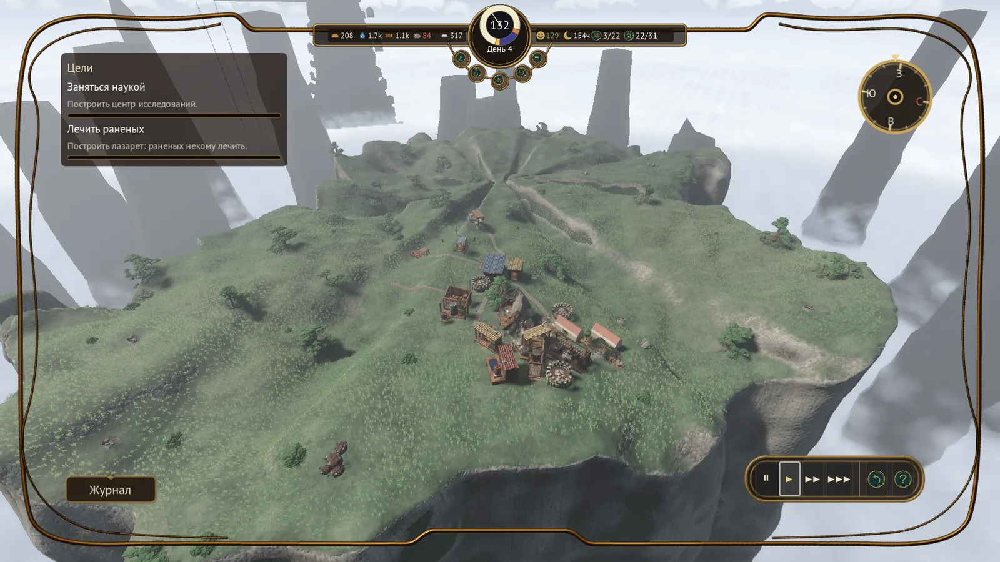

Мой путь в разработке игр начался с движка the Game Factory который поставлялся на CD диске с книгой о разработке игр. Тогда я только осваивал компьютер и мне было интересно сделать что-то похожее на Heroes of mith and magic. Именно эта игра вдохновила во мне интерес к разработке игр на всю оставшуюся жизнь. 

Дальше были 3D движки  3D Cube, Unreal Development Kit и Hammer Engine. Многого я тогда не достиг, попробовал что-то сделать по редким урокам с форумов и туториалов, но знаний и опыта не хватало даже на простые механики.

Тогда я начал осваивать 3D моделирование с Blender 3D. Хотя в те времена он был не популярен и был сложен в освоении, мне он показался удобнее и понятнее конкурентов. Его открытость и свобода оказались решающими для моего развития.

Со временем я стал лучше понимать как устроен процесс создания игр, благо на YouTube начали появляться подробные видео и целые курсы по интересующим меня темам. Я начал по-настоящему понимать, как устроена игровая разработка от пайплайна 3D-моделей до логики механик в движке.

Долгое время я искал работу в игровой индустрии чтобы получить практический опыт, но устроиться не получалось. Я работал вне игровой индустрии и учился по вечерам, повышал свои навыки, тренировал терпение, развивал насмотренность.

Некоторое время я работал на фрилансе, выполнял заказы для анимационных студий, делал визуализации проектов нефтяников и моделировал интерьеры для архитектурных проектов.

В 2020 году я впервые вышел «в свет» с собственным игровым проектом. Я принял участие в конкурсе разработки игр [Unreal Engine Dev Contest 2020 с прототипом игры Soaring Islands]{https://unrealcontest.ru/2020/game/738/}

По ходу разработки я вел [дневники разработки]{https://dtf.ru/indie/768757-postmortem-soaring-islands-heroes-of-exploration}

Сайт [презентация]{https://sites.google.com/view/tuosi/index-en}

Сделал общедоступное [демо прототипа]{https://indiecup.net/eastern-europe/participants/soaring-islands-heroes-of-exploration.html}

После начала войны мне пришлось покинуть страну. Благодаря поддержке друзей я смог уехать и начать жизнь с нуля в другой стране.

Первое время я был волонтером в сообществе которое помогало бегущим от войны.

Через какое-то время я наткнулся на объявление в местном чате о поиске 3D моделлеров на мобильную гоночную игру. Я откликнулся, прислал портфолио (важно иметь портфолио, чтобы было что показать при отклике) и меня взяли на проект симулятор автомеханика. На этом проекте я моделировал автомобили и их запчасти во всех подробностях с учетом аспектов мобильной разработки на Unity и оптимизации под слабые устройства.

Со временем меня перевели на основной проект где я работаю до сих пор. За эти два с половиной года я узнал много о строении и работе автомобилей, их дизайне и истории. 

Я рад что могу работать в этой удивительной и творческой индустрии. Даже спустя два с половиной года я каждый день узнаю что-то новое и получаю уникальный опыт. 

Сейчас настал тот момент когда прошел первый шок от начала войны и я могу продолжать работу над вселенной парящих островов.

Всем добра и попутного ветра!

