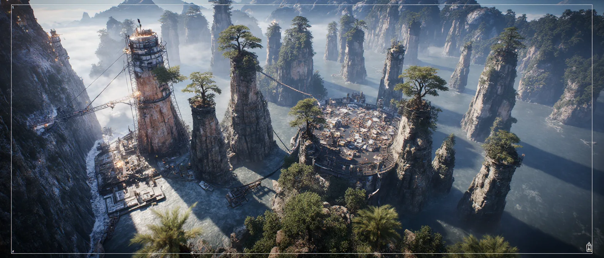

Right now, I’m developing the setting and lore of the Soaring Islands (SI) universe on an as-needed basis—for example, whenever I need to explain how and why people end up on the surface of a mega-amoeba, or why the Empire strips the islands completely bare of resources.

For my game SST (Spire Survive Town), I’ve nailed down a few specific details:

    The surface of the mega-amoeba is covered in massive spires that rise well above its toxic lower atmosphere.

    The poisonous fog is a metabolic byproduct of the mega-amoeba itself. Certain insects can breathe in this atmosphere, but virtually everything else suffocates due to the high concentration of toxic compounds.

    The Ancients once colonized the mega-amoeba’s surface and built their cities at the bases of these spires. All that remains of those cities today are ruins that can be salvaged for resources.

    Any organic matter that falls onto the mega-amoeba’s surface becomes food for the mega-amoeba and spider-like monsters.

    People are doing everything they can to escape this layer, yet there is practically no soaring ore to be found here.

I’ll be documenting all of this in a more detailed, structured format in the encyclopedia section of my blog.

On a side note, yesterday I went fishing with some friends—well, "fishing" might be a stretch. A friend’s son asked us to take him somewhere to try spin fishing for the first time. We drove out to a private lake about 40 kilometers outside the city. Naturally, we didn’t catch a single thing, but we had a great time. It turned into a nice little adventure with friends. I really enjoyed it, even though I ended up exhausted and chilled by the wind. Nothing a hot cup of tea with lemon and ginger couldn't quickly fix, though.

Autumn has arrived in Astana. In the mornings and at night, temperatures are dropping closer and closer to freezing. I’m not a fan of this weather—it’s cold, foggy, and makes you want to sleep all day.

