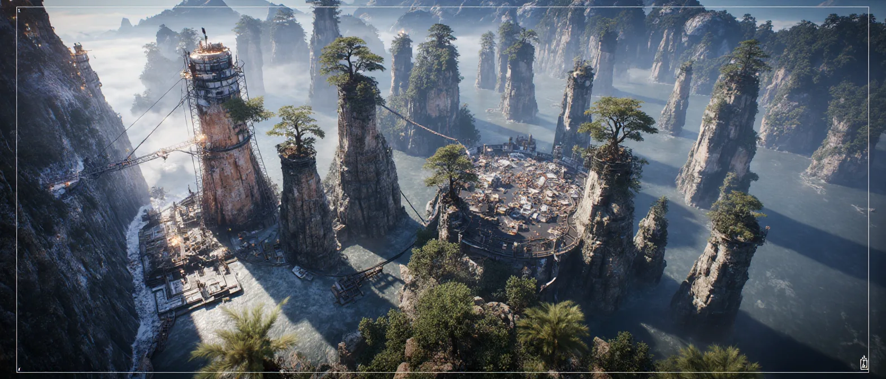

Por el momento, voy desarrollando la ambientación y la historia del mundo de SI a medida que surge la necesidad. Por ejemplo, cuando necesito explicar cómo y por qué las personas terminan en la superficie de una mega-ameba, o por qué el Imperio agota todos los recursos de las islas.

Para el juego SST precisé los siguientes detalles:

    La superficie de la mega-ameba está cubierta de agujas rocosas que sobresalen por encima de la atmósfera propia de la mega-ameba.

    La niebla venenosa es un subproducto de la actividad vital de la mega-ameba. Algunos insectos pueden respirar en esa atmósfera, pero prácticamente todo lo demás muere asfixiado debido a la concentración de sustancias tóxicas.

    Los Antiguos colonizaron la superficie de la mega-ameba y construyeron sus ciudades al pie de las agujas. De aquellas ciudades solo quedan ruinas que pueden desmantelarse para obtener recursos.

    Cualquier materia orgánica que cae sobre la superficie de la mega-ameba se convierte en alimento para ella y para los monstruos araña.

    Los humanos hacen todo lo posible por escapar de esta capa, pero aquí prácticamente no hay mena flotante.

Todo esto lo describiré de manera más detallada y estructurada en la sección enciclopédica de mi blog.

Por cierto, ayer fuimos a pescar con unos amigos. Bueno, «a pescar» es un decir. El hijo de un amigo pidió que lo lleváramos a algún lado a probar la pesca con caña de spinning. Fuimos a un lago privado a 40 km de la ciudad. Por supuesto, no pescamos nada, pero pasamos un rato muy entretenido. Fue una pequeña aventura entre amigos. Me gustó mucho, aunque terminé cansado y me agarró el viento frío. Pero no pasa nada, un té con limón y jengibre me calentó rápido.

En Astaná ya empezó el otoño. Por las mañanas y por las noches la temperatura baja cada vez más cerca de cero. No me gusta este clima: hace frío, hay neblina y da mucho sueño.

