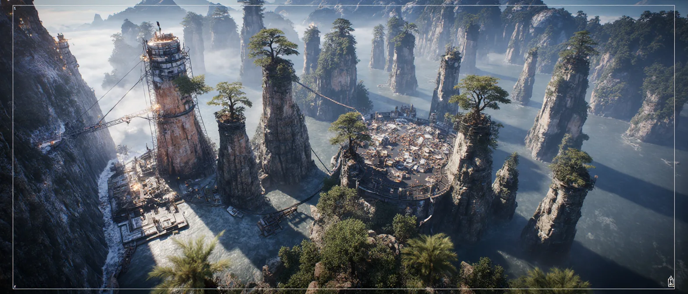

На данный момент я занимаюсь развитием сеттинга и истории мира SI по мере необходимости. Например если мне нужно рассказать о том как и почему люди оказываются на поверхности мега-амебы или почему Империя вырабатывает все ресурсы из островов.

Для игры SST я уточнил такие моменты:

Поверхность мега-амебы покрыта шпилями которые выходят за область атмосферы меша-амебы. 

Ядовитый туман это продукт жизнедеятельности мега-амебы. Некоторые насекомые могут дышать в этой атмосфере, но практически все остальное задыхается из-за концентрации отравляющих веществ.

Древние осваивали поверхность мега-амебы и строили свои города у подножий шпилей. От этих городов остались только руины, которые можно разобрать на ресурсы.

Любая органика попавшая на поверхность мега-амебы становится кормом для мега-амебы и монстров-пауков.

Люди всеми силами стараются выбраться из этого слоя, но здесь практически нет парящей руды.

Все это в более подробном и структурированном виде я опишу в энциклопедической части моего блога.

Кстати вчера ездили с друзьями на рыбалку. Ну как на рыбалку. Сын друга попросил свозить его куда-нибудь  попробовать рыбачить на спиннинг. Мы приехали на частное озеро в 40 км от города. Конечно ничего не поймали, зато интересно провели время. Такое маленькое приключение вместе с друзьями. Мне очень понравилось, хоть я и устал и меня продуло ветром. Но ничего страшного, чай  с лимоном и имбирем быстро меня согрел.

В Астане началась осень. По утрам и ночью температура опускается все ближе к нулю. Не люблю такое, холодно, туманно, хочется спать.

