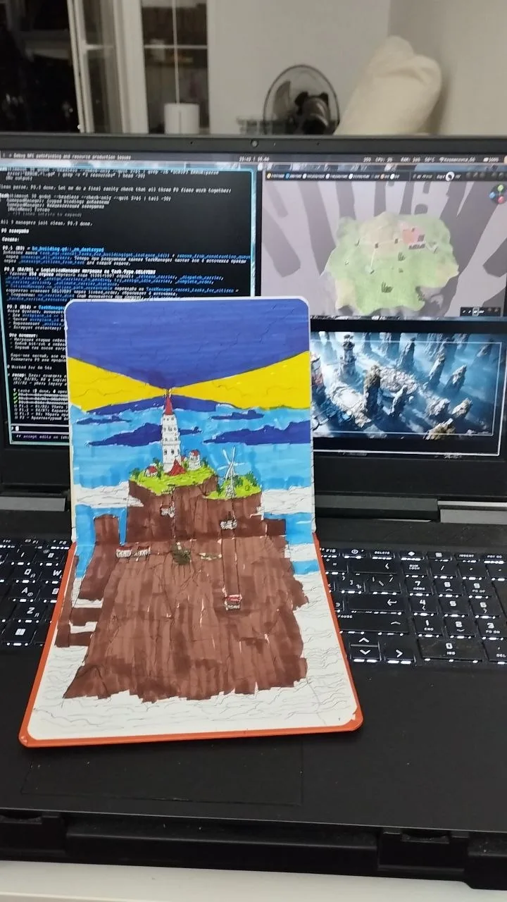

Welcome to Flamti.org — a space dedicated to my creative work, the universe of floating islands, and my journey through life.

My name is Flamti. I’m a 3D artist with a background in the mobile games industry. In my free time, I’m building the universe of Soaring Islands.

I construct this world layer by layer, shaping its mechanics, inhabitants, culture, architecture, and legends. I’m creating a living universe designed to evolve and grow. It’s important to me that these floating islands feel genuinely alive — like a place you’d actually want to call home.

My dream is to share the world of Soaring Islands with as many people as possible. I want to create compelling, high-quality games across different genres, write short stories and novels set in this universe, publish a comic or manga, and, ultimately, direct a feature film.

Right now, I’m developing a prototype for a city-building simulator. Players find themselves atop a colossal spire surrounded by a dense, toxic fog. They will have to survive, build, make tough choices, and strike a balance between sheer survival and humanity. I draw inspiration from games like Frostpunk, Dishonored, and Disco Elysium, though the realities of Soaring Islands dictate their own distinct rules and mechanics.

On this blog, I share not only my development progress, but also world stories, lore, visual discoveries, and a behind-the-scenes look at the creative process. It’s the journal of someone dreaming of creating a true work of art.

To me, this site is more than just a devlog; it’s a way to share my passion, reflect on my creative path from the outside, and hopefully connect with like-minded people. I’d love to hear your comments, thoughts, and ideas.

