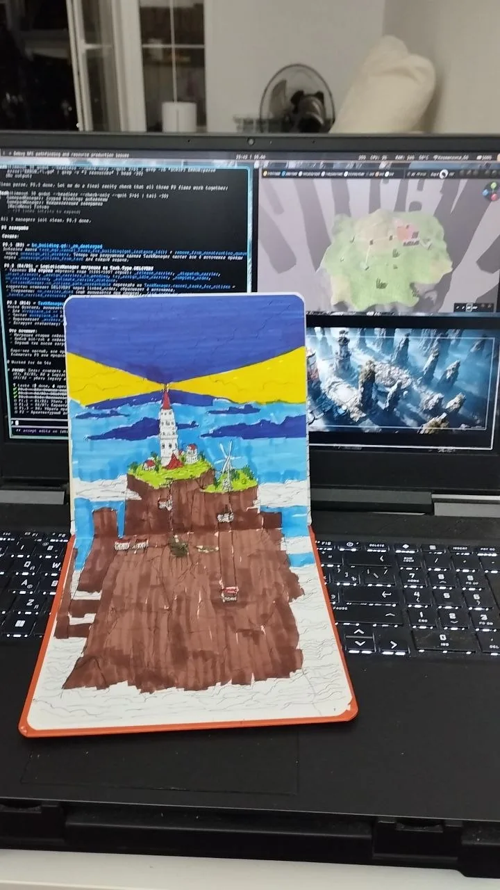

Te doy la bienvenida a Flamti.org, un sitio dedicado a mi obra creativa, al universo de las islas flotantes y a cómo transcurre mi vida.

Me llamo Flamti. Soy artista 3D con experiencia en la industria de los videojuegos para móviles. En mi tiempo libre me dedico a desarrollar el universo de Soaring Islands.

Construyo este mundo capa por capa: ideo su estructura, sus habitantes, su cultura, su arquitectura y sus leyendas. Estoy creando un universo vivo que seguirá evolucionando y creciendo. Para mí es importante que las islas flotantes de este mundo se sientan reales, como un lugar en el que te gustaría vivir.

Mi sueño es dar a conocer el mundo de Soaring Islands al mayor número posible de personas. Quiero crear videojuegos buenos, de calidad y apasionantes en distintos géneros, escribir relatos y novelas ambientados en este universo, publicar un cómic o un manga y, por supuesto, rodar un largometraje.

Actualmente estoy desarrollando el prototipo de un simulador de construcción de ciudades. Los jugadores se encontrarán en la cima de una aguja rocosa rodeada por una niebla densa y venenosa. Tendrán que sobrevivir, construir, tomar decisiones difíciles y encontrar el equilibrio entre la supervivencia y la humanidad. Me inspiran juegos como Frostpunk, Dishonored y Disco Elysium, pero la realidad del mundo de Soaring Islands impone sus propias particularidades y reglas únicas.

En este blog comparto no solo el progreso del desarrollo, sino también historias de este mundo, su lore, hallazgos visuales y el detrás de cámaras del proceso creativo. Es el diario de alguien que sueña con crear una verdadera obra de arte.

Para mí, este blog no es solo una crónica de desarrollo; es una forma de compartir mi pasión, mirar mi camino creativo desde otra perspectiva y, tal vez, encontrar personas afines. Estaré encantado de leer sus comentarios, reflexiones e ideas.

