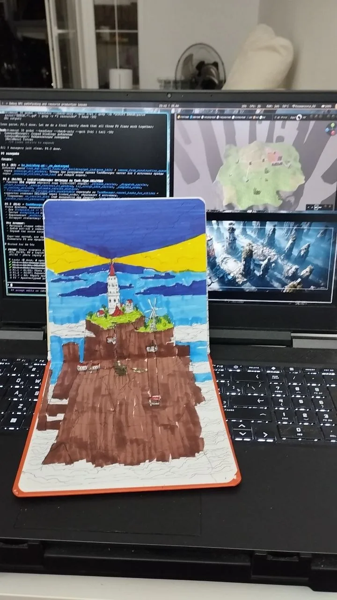

Добро пожаловать на сайт Flamti.org посвященный моему творчеству, вселенной парящих островов и тому как идет моя жизнь.

Меня зовут Flamti. Я 3D художник с опытом работы в индустрии мобильных игр. В свое свободное время я занимаюсь разработкой вселенной Soaring Islands. 

Я строю этот мир слой за слоем: придумываю его устройство, население, культуру, архитектуру и легенды. Строю живую вселенную которая будет развиваться и расти. Мне важно, чтобы парящие острова этого мира ощущались живыми - как место, в котором хочется жить.

Моя мечта рассказать о мире Soaring Islands как можно большему количеству людей. Я хочу создавать хорошие, качественные и  захватывающие игры в разных жанрах, писать рассказы и романы во вселенной, выпускать комикс или мангу и конечно снять полнометражный фильм. 

Сейчас я разрабатываю прототип градостроительного симулятора. Игроки окажутся на вершине шпиля, окружённого плотным, ядовитым туманом. Им предстоит выживать, строить, принимать трудные решения и находить баланс между выживанием и человечностью. Меня вдохновляют такие игры как Frostpunk, Dishonored, Disco Elysium но действительность мира Soaring Islands диктует свои особенности и уникальные правила.

В этом блоге я делюсь не только прогрессом разработки, но и историями мира, лором, визуальными находками и закулисьем творчества. Это дневник человека, который мечтает создать настоящее произведение искусства.

Для меня этот блог не просто хроника разработки, это способ поделиться своей страстью, взглянуть на творческий путь со стороны и, возможно, найти единомышленников. Буду рад вашим комментариям, мыслям и идеям.

