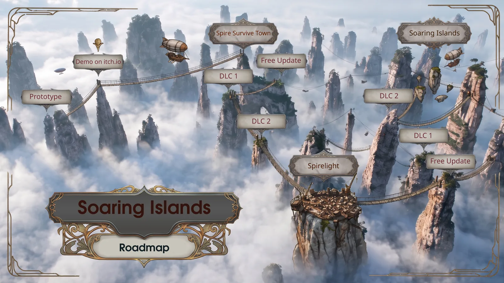

I want to visualize my game development plans for the Soaring Islands universe. To start, I’ve mapped out the path from the SST prototype all the way to the flagship Soaring Islands game.

Right now, the early prototypes—each showcasing different stages of development—are complete, and a public demo is available on itch.io. This demo serves as a playable vertical slice:
[playable demo Spire Survive Town](https://flamti-gamedev.itch.io/sst-demo)

---

## Spire Survive Town

Following the public demo, I’m moving full steam ahead toward a Steam release. Registering as a developer on Steam requires paying a $100 fee and submitting banking and tax information. While I wait for my account to be approved, I’m using the downtime to focus on my blog and the game's marketing.

In today’s market—and based on advice from experienced developers—I’ve decided to concentrate my marketing push into the final week before launch so that copycats don’t have time to clone the finished game based on early promotional materials.

I’m targeting a release window of January–February 2027.

The first free update will introduce new buildings, spire generator modifiers, and a Scenario Mode—allowing players to build and play through pre-scripted narrative campaigns. I plan to release this update no later than April 2027.

Two planned DLCs will add new storylines and generation tools. Their pricing will depend directly on how well the base game sells.

Above all, my goal is to create successful games that allow me to keep doing what I love—and eventually relocate somewhere without winter.

## Spirelight

The next full-scale title will be Spirelight—a sequel to SST that shifts the world into a multiplayer model. It may become a full-fledged MMO strategy game, or I might implement player-hosted co-op sessions. The exact multiplayer architecture will depend on my budget and whether I can afford to rent a solid dedicated server.

Either way, I want players to be able to cooperate or compete on the same map in real time.

Spirelight won’t just be a single settlement perched on one small spire; it will be a sprawling city built across multiple spires, with a strong emphasis on logistics and exploration.

By the time Spirelight is in production, I plan to hire a small team—including writers—so we can craft an engaging story about the colonization of the spires.

## Soaring Islands

The final game in this trilogy will realize my original vision: developing colonies on floating islands and managing logistics in a constantly shifting world. The islands drift with the wind, making resource delivery a challenging task complicated even further by the unpredictable behavior of other players.

Soaring Islands will be a multiplayer game with a single-player option. Building and maintaining connections between islands will serve as its core mechanic.

---

I estimate the entire journey will take around 5 years if everything goes according to plan and I can bring people onto the team. If I continue developing these games solo, however, reaching the release of Soaring Islands could take up to 10 years.

