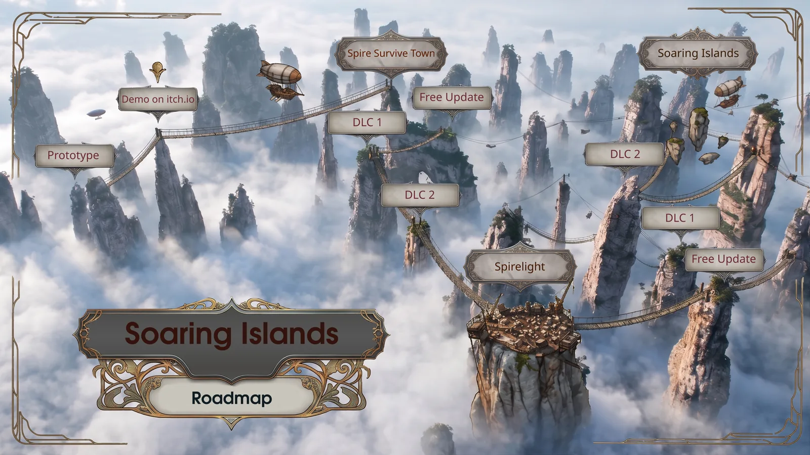

Quiero visualizar mis planes para el desarrollo de videojuegos ambientados en el universo de las islas flotantes. Para empezar, decidí trazar el camino desde el prototipo de SST hasta el juego principal sobre las islas flotantes.

Por el momento, ya están listos los primeros prototipos —cada uno de los cuales refleja distintas etapas del desarrollo— y también una demo pública en itch.io. Esta demo representa una porción vertical jugable (vertical slice):
[demo](https://flamti-gamedev.itch.io/sst-demo)

---

## Spire Survive Town
Tras lanzar la demo pública, me puse a avanzar a toda máquina hacia el lanzamiento en Steam. Para registrarse allí como desarrollador, es necesario pagar una tarifa de 100 dólares estadounidenses y proporcionar información bancaria y fiscal. Mientras espero la aprobación, tengo tiempo para dedicarme al blog y al marketing del juego.

En el panorama actual, siguiendo los consejos de desarrolladores experimentados, decidí concentrar el marketing durante la semana previa al lanzamiento, para que no dé tiempo a que copien el juego terminado a partir de los materiales promocionales.

Planeo el lanzamiento para enero o febrero de 2027.

La primera actualización gratuita añadirá nuevos edificios, modificadores del generador de la aguja y el modo de escenarios: la posibilidad de construir campañas narrativas en las que los jugadores podrán jugar historias previamente escritas. Planeo lanzarla a más tardar en abril de 2027.

Dos DLC incluirán nuevas tramas y herramientas de generación. Su precio dependerá directamente de las ventas del juego base.

En cualquier caso, quiero crear juegos exitosos que me permitan seguir dedicándome a lo que amo y mudarme a un lugar donde no haya invierno.

## Spirelight
El siguiente juego completo será Spirelight: una secuela de SST y la transición hacia un modelo de mundo multijugador. Es posible que el juego sea completamente un MMO de estrategia o que añada la opción de iniciar sesiones cooperativas en las PC de los propios jugadores. La forma concreta del multijugador dependerá del presupuesto y de si puedo costear el alquiler de un servidor decente.

De cualquier manera, quiero que los jugadores puedan cooperar o enfrentarse en un mismo mapa en tiempo real.

Spirelight ya no será solo un asentamiento en una pequeña aguja rocosa, sino una extensa ciudad construida sobre múltiples agujas. En esta entrega se prestará gran atención a la logística y la exploración.

Para cuando salga Spirelight, planeo contratar a un pequeño equipo, incluidos guionistas con quienes crearemos una historia apasionante sobre la colonización de las agujas.

## Soaring Islands
El último juego de esta serie será la materialización de mi idea original: el desarrollo de colonias en islas flotantes y la logística en un mundo en constante cambio. Las islas van a la deriva a merced del viento, y transportar recursos no es tarea fácil, algo que se complicará aún más por lo impredecible del comportamiento de los jugadores.

SI será un juego multijugador con posibilidad de jugarlo en solitario.

Construir y mantener conexiones es la mecánica fundamental de las islas flotantes.

---

Calculo que recorrer todo este camino me tomará alrededor de 5 años si todo sale según lo planeado y logro contratar gente para el equipo. En cambio, si sigo desarrollando estos juegos en solitario, llegar hasta el lanzamiento de SI podría llevarme incluso 10 años.

