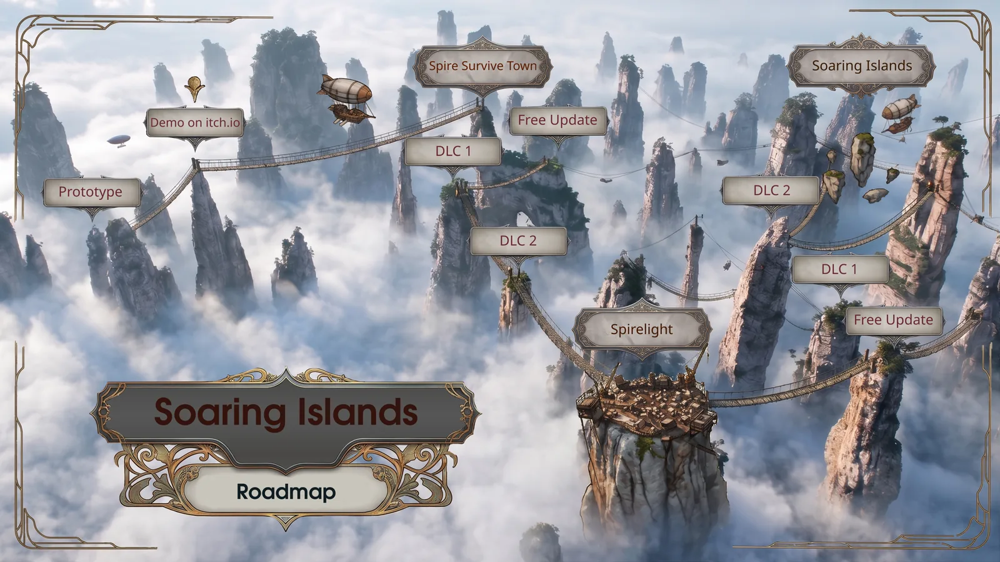

Я хочу визуализировать свои планы на разработку игр по вселенной парящих островов.

Для начала я решил взять путь от прототипа SST к игре про парщие острова

На данный момент готовы первые прототипы, каждый из которых показывает этапы разработки, и готово публичное демо на itch.io 

это демо представляет собой вертикальный срез в который можно поиграть

[демо Spire Survive Town](https://flamti-gamedev.itch.io/sst-demo)

---

## Spire Survive Town

После публичного демо я на всех парах устремился к релизу на платформе Steam. Для регистрации там как разработчика, нужно оплатить взнос 100 долларов сша и предоставить банковскую и налоговую информацию. Пока жду одобрения, есть время заняться блогом и маркетингом игры.

В текущих реалиях, по советам опытных разработчиков, я решил проводить маркетинг в течении недели перед релизом, чтобы готовую игру не успели скопировать по маркетинговым материалам.

Релиз я планирую в январе-феврале 2027 года. 

Первое бесплатное обновление добавит новые здания, модификаторы генератора шпиля и режим сценариев - возможность строить сюжетные кампании в которых игроки будут отыгрывать заранее прописаные истории. Выпустить его я планирую не позднееапреля 2027 года.

Два DLC будут включать в себя новые сюжеты и инструменты генерации. Их цена будет напрямую зависеть от продаж основной игры. 

В любом случае я хочу создавать успешные игры которые помогут мне и дальше заниматься любимым делом и переехать туда, где нет зимы.

## Spirelight

Следующей полноценной игрой станет Spirelight - продолжение SST и переход к мультиплеерной модели мира. Возможно игра будет полностью MMO стратегией или же я добавлю возможность запуска кооперативных сессий на пк игроков. Конкретная форма мультиплеера будет зависеть от бюджета, смогу ли я арендовать приличный сервер.

В любом случае я хочу чтобы игроки могли сотрудничать или сражаться на одной карте, в реальном времени. 

Spirelight будет уже не просто поселением на маленьком шпиле, это будет обширный город построенный на множестве шпилей. Большое внимание в этой части будет уделено логистике и исследованиям.

К моменту выхода Spirelight я планирую нанять небольшой штат, включая писателей с которыми создадим захватывающую историю освоения шпилей.

## Soaring Islands

Последней игрой этой сериии станет реализация моей первоначальной идеи - развитие колоний на парящих островах и логистика в постоянно меняющемся мире. Острова дрейфуют по воле ветра и доставлять ресурсы не простая задача, которая будет усложняться непредсказуемостью поведения игроков. 

SI будет мультиплеерной игрой с возможностью одиночного прохождения. 

Строить и поддерживать связи это основная механика парящих островов.

---

На реализацию всего пути я предполагаю около 5 лет, если все пойдет по плану и я смогу нанимать людей в команду. Если же я продолжу делать эти игры в одного до релиза SI может уйти и 10 лет.

