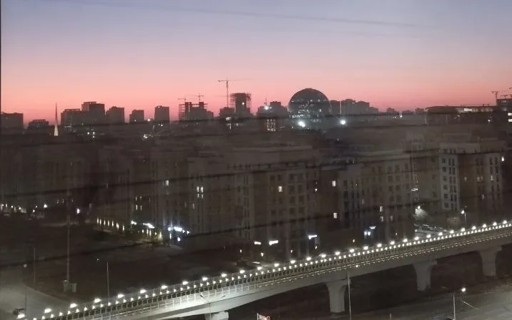

While I wait for my Steamworks developer account to be approved, I’m directing Claude Code’s resources toward improving the visuals of the buildings. Together with Gemini, we reviewed screenshots of the current building models, pinpointed exactly what needed upgrading on each structure, and put together several concepts for most of them. Now, Claude Code is using Blender MCP to refine the existing 3D models based on those notes and concepts.

So far, I’m not thrilled with every single result. We’ll continue iterating on the visuals of each building until everything feels organic and cohesive-blending Art Nouveau aesthetics with the harsh realities of surviving an airship crash.

At my day job, they’ve started offering remote work options, though I actually live in the exact same building as the office, so switching to remote doesn't really make sense for me right now. I’d love to move to Latin America and work remotely from there eventually, but that’s going to require a higher income first.

