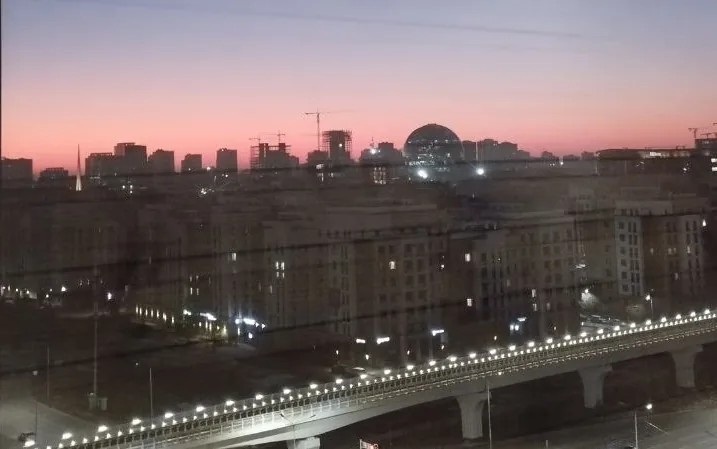

Mientras espero la aprobación de mi cuenta de desarrollador en Steamworks, estoy enfocando los recursos de Claude Code en mejorar el aspecto visual de los edificios. Con la ayuda de Gemini analizamos capturas de pantalla de los modelos actuales, definimos qué aspectos específicos mejorar en cada edificio y preparamos varios conceptos para la mayoría de ellos. Ahora Claude Code, utilizando Blender MCP, está intentando perfeccionar los modelos existentes basándose en esas anotaciones y conceptos.

Por ahora no me gustan todos los resultados. Seguiremos puliendo el apartado visual de cada edificio para que se vea orgánico y coherente, combinando la estética art nouveau con las duras condiciones de supervivencia tras el accidente de un transporte volador.

En el trabajo empezaron a ofrecer modalidad remota, pero como vivo en el mismo edificio donde está la oficina, por el momento no le veo sentido a pasarme al trabajo remoto. Me gustaría mudarme a Latinoamérica y trabajar a distancia, pero para eso necesito un ingreso mayor.

