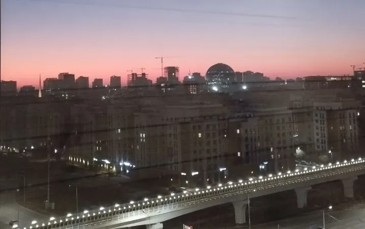

Пока я жду одобрения аккаунта разработчика на steamworks, направляю ресурсы Claude Code на улучшение визуала зданий. С помощью Gemini мы разобрали скриншоты текущих моделей зданий и определили что именно улучшать в визуале каждого здания и по большей части зданий подготовили несколько концептов. Claude Code  используя Blender MCP пытается доработать существующие модели зданий по отметкам и концептам.

Пока что не все результаты мне нравятся. Мы будем еще дорабатывать визуал каждого здания, чтобы оно смотрелось органично и логично, сочетая эстетику ар-нуво и суровые условия выживания при крушении летающего транспорта.

На работе стали предлагать удаленку, но я живу в том же здании что и офис. Не вижу смысла пока что уходить на удаленную форму работы. Я бы хотел переехать в латинскую америку, и работать на удаленке, но для этого требуется доход побольше.

