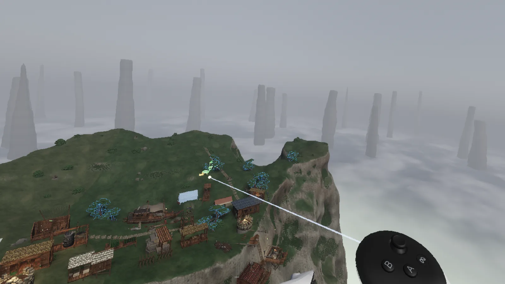
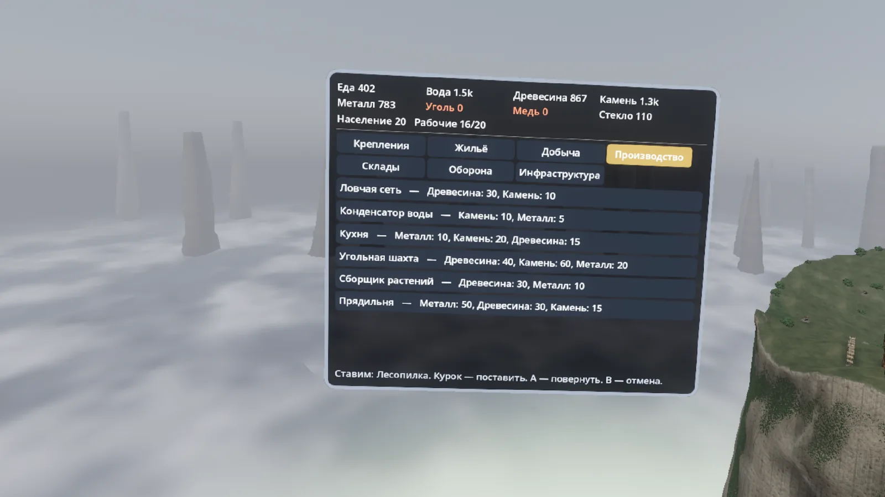
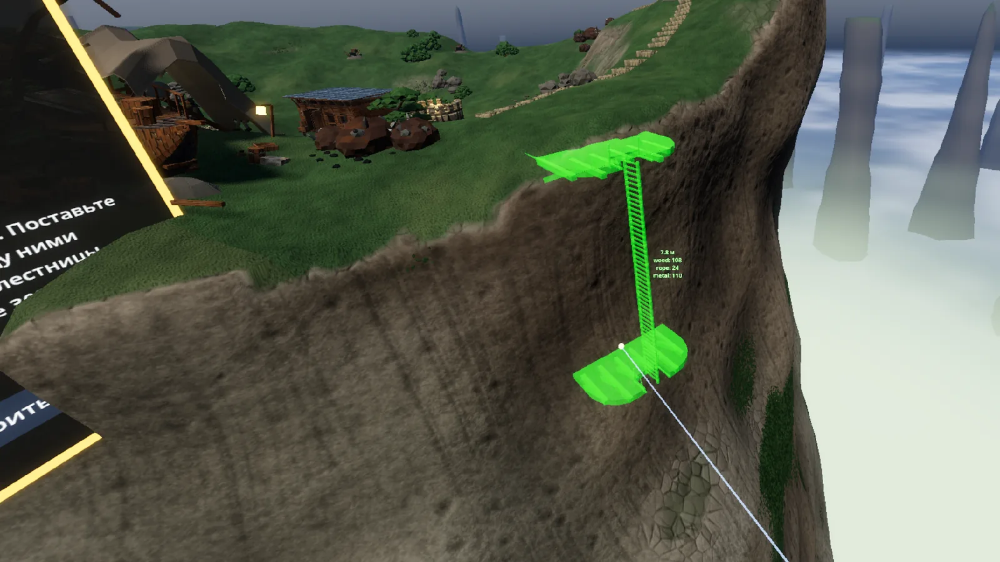
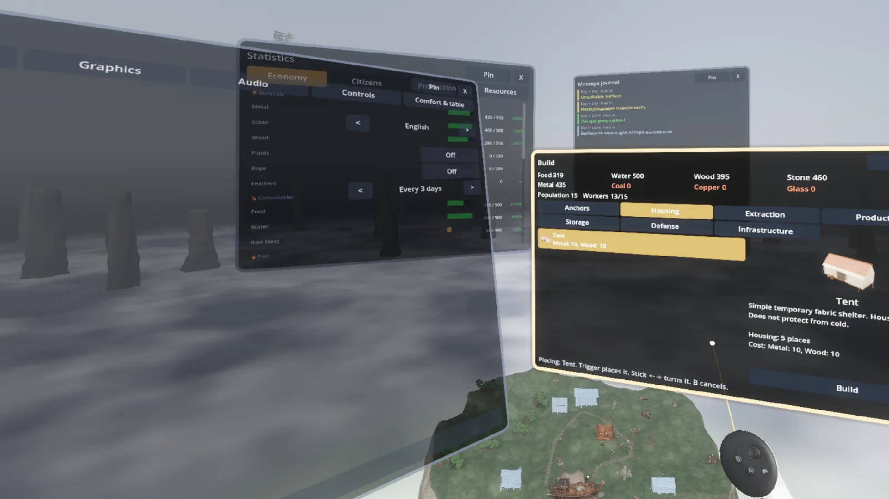

I really love VR. I own a Meta Quest 3 headset equipped with a BoboVR head strap and extra battery packs.

I love playing VR games and truly believe they are the future.

I tried building my own VR engine—the idea was to create a VR platform where it would be intuitive to assemble levels and gameplay logic directly inside virtual reality.

[video on YouTube](https://youtu.be/2o1Ai5l1jA4?si=CyCUkp8VDt-4X7Rr)

I’ve put the engine itself on hold for now to focus on polishing SST. However, I did add a VR mode to my game. Surprisingly, it turned out to be much easier than I expected.

By the end of the week, I came down with a high fever—39.5°C. I spent the time resting in bed and drinking hot tea.

