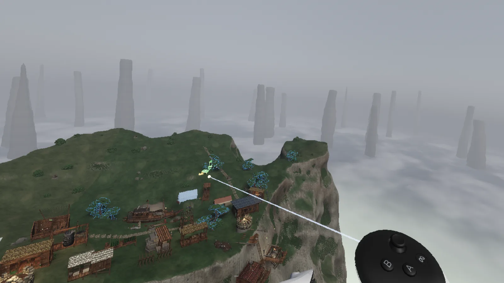
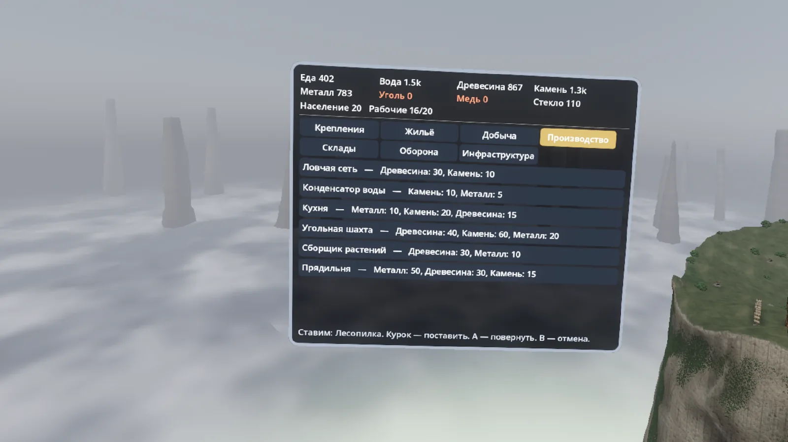
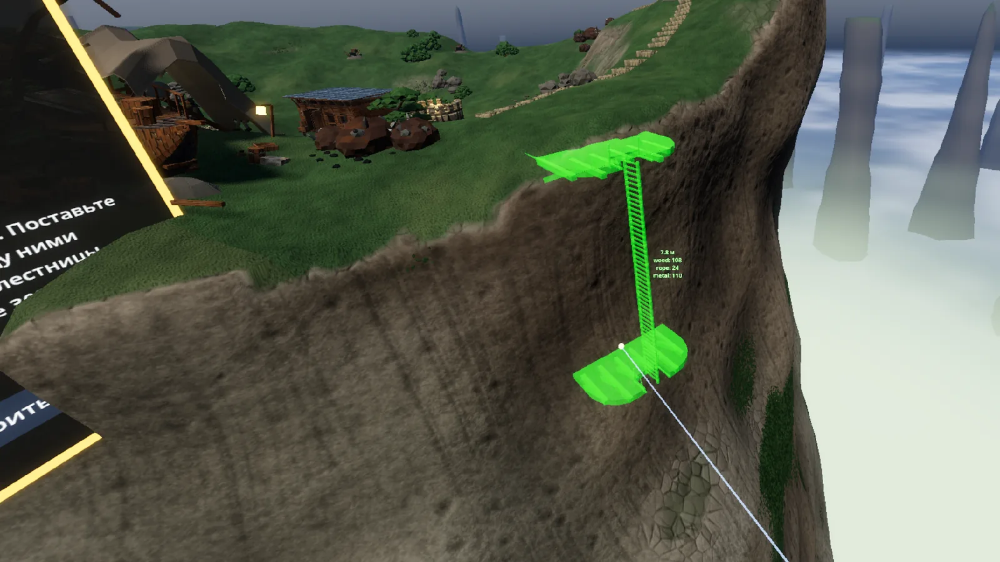
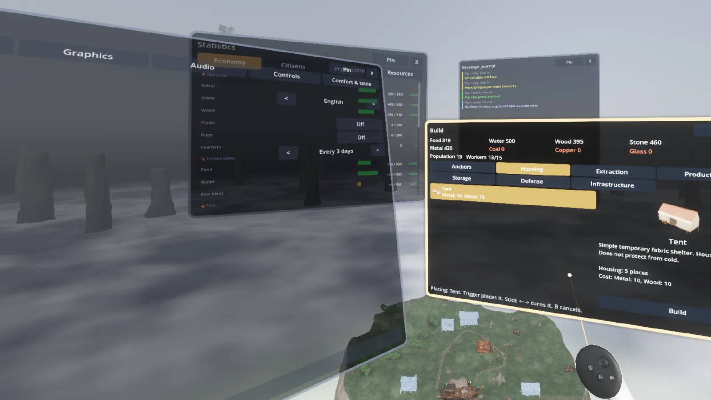

Me gusta muchísimo la realidad virtual (VR). Tengo un visor Meta Quest 3 con correas y baterías adicionales de BoboVR.

Me encanta jugar títulos en VR y creo firmemente que el futuro está en ellos.

Intenté crear un motor de VR; la idea era desarrollar una plataforma en realidad virtual en la que resultara cómodo armar niveles y construir la lógica del juego.

[vido youtube](https://youtu.be/2o1Ai5l1jA4?si=CyCUkp8VDt-4X7Rr)

Por el momento dejé de lado el motor propio para concentrarme en pulir SST. Sin embargo, añadí un modo VR a mi juego. Para mi sorpresa, resultó mucho más sencillo de lo que pensaba.

Hacia el final de esta semana me enfermé. Tuve 39,5 grados de fiebre, así que me quedé descansando en cama y tomando té caliente.

