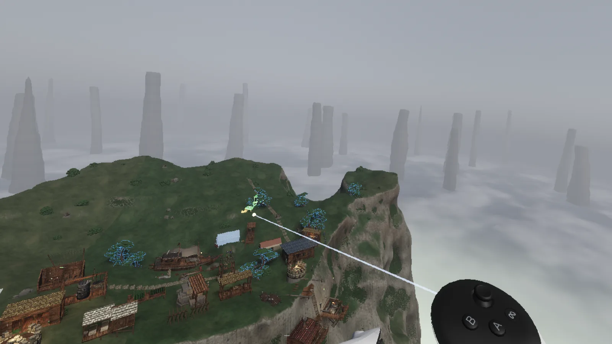
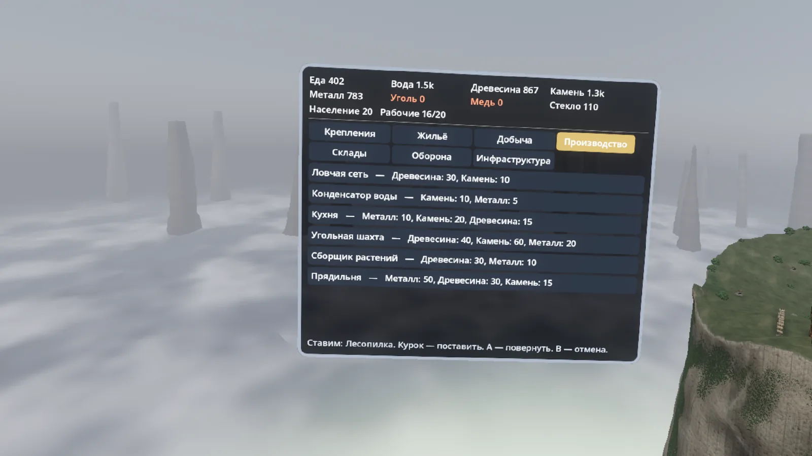
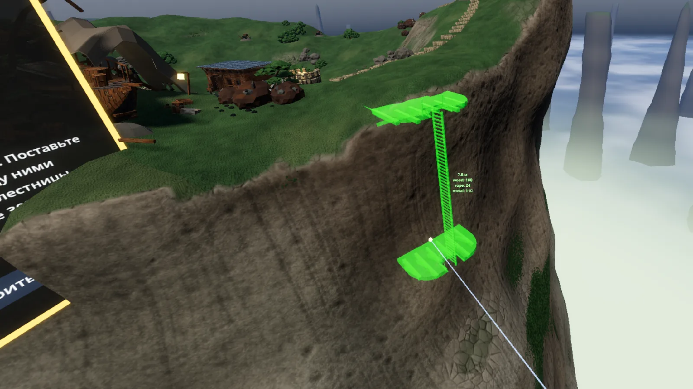
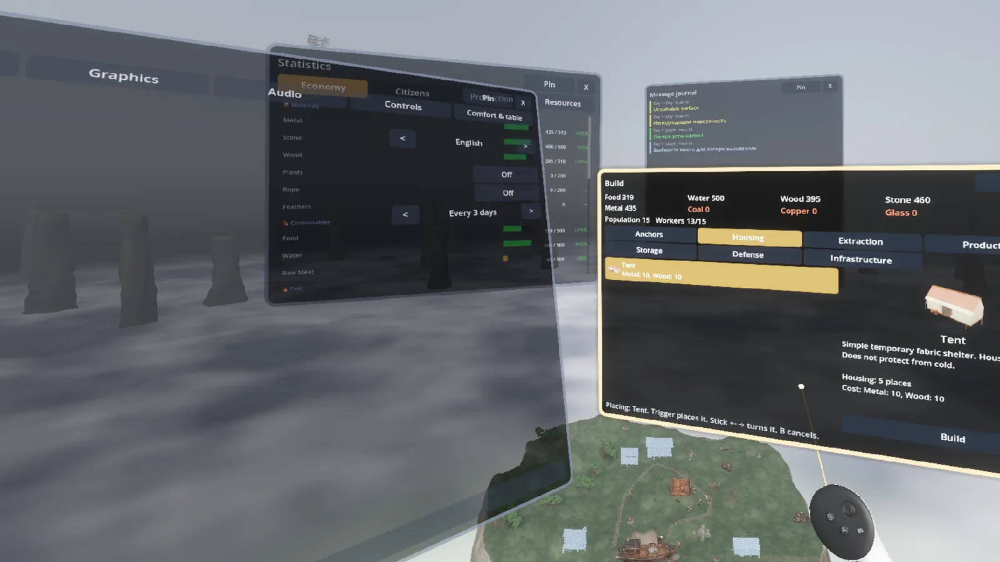

Мне очень нравится VR. У меня есть шлем  Meta Quest 3 с креплениями и дополнительными аккумуляторами Bobo VR. 

Я очень люблю играт в VR игры и считаю что будущее за ними. 

Я попробовал сделать VR движок, идея была в том, чтобы создать VR платформу в которой будет удобно собирать уровни и логику. 

[Видео на ютубе](https://youtu.be/2o1Ai5l1jA4?si=CyCUkp8VDt-4X7Rr)

Сам движок я пока что забросил, чтобы сфокусироваться на доработке SST. В свою игру я добавил VR режим. На удивление это оказалось проще чем я думал.

Под конец этой недели я заболел. Температура 39,5 градусов. Отлеживался и пил горячий чай.

